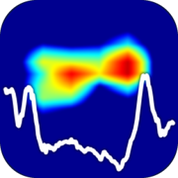
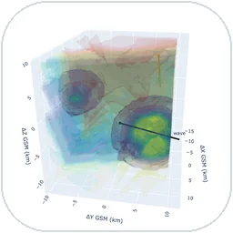
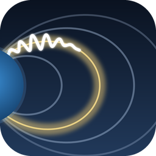
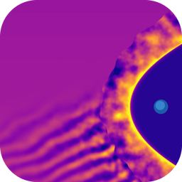

# Hi, I'm Sal — Space Plasma Physicist

I study wave–plasma interactions in the near-Earth space environment, with a focus on how structured ionospheric and magnetospheric plasmas control wave propagation, and particle dynamics, and space weather.

## Research
- Ionosphere–magnetosphere coupling
- Wave–particle interactions
- Radiation belt dynamics

## Methods
- Theoretical and computational modeling
- Active ionospheric experiments
- Spacecraft and ground-based observations
- Data analysis
- AI-enabled tools for space physics
## Current projects

<table width="100%">
<tr>
<td>

### Active Ionospheric Heating Simulation Platform

**STRUM (Simulator of Transmitter Response in the Upper atmosphere and Magnetosphere)** 
A numerical platform for heating experiments at HAARP with ULF and VLF modulation, written from the governing equations. It follows the beams from the array through the lower ionosphere and up the magnetic flux tube: the heated electrons, the currents they drive, and the ULF and VLF signals at the receivers. An inverse mode fits the model to the records of an experiment, and physics-informed neural networks solve parts of the same equations. To strum is to sweep a hand across the strings of a harp.

**[Explore the project →](ACTIVE_IONOSPHERIC_HEATING.md)**

</td>
</tr>
</table>

 

<table width="100%">
<tr>
<td>

### Magnetospheric Duct Observation and Analysis

**DuctLab** is the AI-assisted platform I'm building to detect magnetospheric ducts in NASA's MMS data across the whole mission. A detector picks out localized structures in the magnetic field and plasma density, machine-learning models score them, and every label my colleagues and I give goes into training the next model.

**[Explore the project →](https://sanejad.github.io/DuctLab-Overview/)**

</td>
</tr>
</table>

 

<table width="100%">
<tr>
<td>

### <a href="PLASMA_DUCT_MORPHOLOGY.md"><picture><source media="(prefers-reduced-motion: reduce)" srcset="https://raw.githubusercontent.com/SANejad/SANejad/main/assets/profile/duct-morphology-icon-still.webp"></picture></a>Plasma Duct Morphology and Whistler-Mode Wave Dynamics

A three-dimensional investigation of plasma-duct structure and whistler-mode wave dynamics. The project examines how wave activity is embedded within magnetic-field and plasma-density structures, how duct morphology evolves, and how duct geometry controls wave localization, confinement, leakage, and propagation pathways.

**[Explore the project →](PLASMA_DUCT_MORPHOLOGY.md)**

</td>
</tr>
</table>

 

<table width="100%">
<tr>
<td>

### ELF–VLF Whistler-Mode Wave Ducting and Wave–Particle Interaction

An investigation of how plasma-density and magnetic-field structures guide ELF/VLF whistler-mode waves and modify their interaction with energetic electrons. The project examines wave localization, propagation pathways, resonance conditions, and the role of ducting in particle acceleration, scattering, and precipitation.

**[Explore the project →](ELF_VLF_WHISTLER_DUCTING_AND_WPI.md)**

</td>
</tr>
</table>

 

<table width="100%">
<tr>
<td>

### Pickup-Ion Waves and Wave Ducting in the Solar Wind

An observational study with data from NASA's IMAP mission at the Sun–Earth L1 point and from Parker Solar Probe closer to the Sun. The project examines how density and magnetic-field structures in the solar wind, such as channels, dips, and discontinuities, guide ion-cyclotron and whistler-mode waves, and when waves driven by interstellar pickup ions can grow above the solar-wind turbulence.

**[Explore the project →](SOLAR_WIND_WAVE_DUCTING.md)**

</td>
</tr>
</table>

## Contact

For research collaboration, project discussion, or space-plasma modeling questions, feel free to reach out through GitHub.
