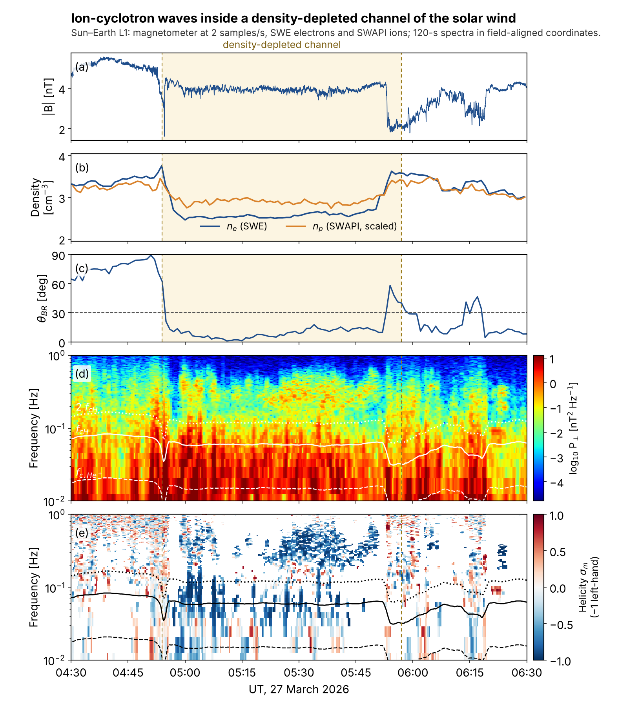
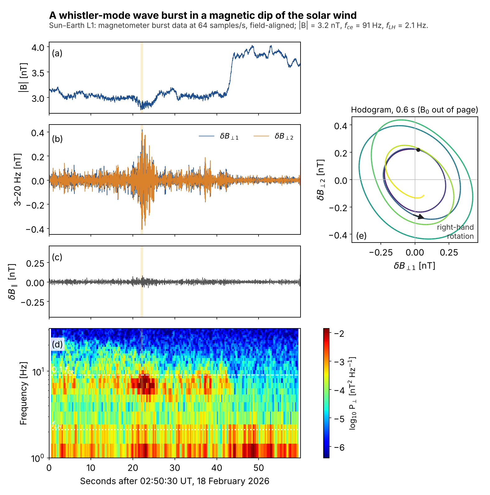

# Pickup-Ion Waves and Wave Ducting in the Solar Wind

> A research project on how density and magnetic-field structures in the solar wind select, guide, and trap ion-cyclotron and whistler-mode waves, and on when waves driven by interstellar pickup ions can grow, using NASA's IMAP mission at the Sun–Earth L1 point and Parker Solar Probe closer to the Sun.

[← Back to main profile](https://github.com/SANejad)

## Overview

This project studies the connection between **solar-wind structure**, **wave growth**, and **wave guiding**. The central premise is that where a wave is observed in the solar wind depends not only on the instability that drives it, but also on the density and magnetic-field structures that can trap, guide, or suppress it. The same idea underlies my work on magnetospheric ducts, where field-aligned channels of enhanced or depleted density and field strength trap and guide whistler-mode waves.

## Scientific motivation

Electromagnetic waves near the proton cyclotron frequency are a recurrent feature of the solar wind at 1 au. Proposed sources include proton temperature anisotropy, ion beams, and the ring-beam distributions of interstellar pickup ions. Pickup ions are born on an unstable ring in velocity space and should excite ion-cyclotron waves throughout the solar wind, yet such waves are rarely observed near Earth. The accepted explanation, that the wave growth must outrun the turbulent cascade at the resonant scale, has not yet been tested with the pickup-ion density, the turbulence, and the waves all measured on one spacecraft.

Whistler-mode waves are the electron-scale counterpart. At 1 au they appear between the lower-hybrid frequency and a fraction of the electron cyclotron frequency, and near the Sun, Parker Solar Probe has found them collocated with localized magnetic-field dips. Whether solar-wind structures sort these two wave families, and whether they act as ducts for them, as density and field structures do in the magnetosphere, is an open question.

## Data

- **IMAP**, at the Sun–Earth L1 point since January 2026, from the mission's first public data release:
  - **MAG:** the magnetic field at 2 samples per second, and burst data at 64 samples per second that resolve whistler-mode waves;
  - **SWE:** electron moments at about one-minute cadence;
  - **SWAPI:** solar-wind ion spectra every 12 s, and He+ pickup-ion densities obtained by applying the mission's Level-3 algorithm to the Level-2 data.
- **Parker Solar Probe:** magnetic-field and plasma measurements closer to the Sun, where whistler-mode waves have been found in magnetic-field dips, to follow the same questions into the inner heliosphere.

## Examples from the data

### Ion-cyclotron waves inside a density-depleted channel

  

On 27 March 2026 the spacecraft crossed a channel of the solar wind about an hour wide, from 04:54 to 05:57 UT, bounded by sharp changes in the field and the density. Inside it the electron density drops by about a quarter (b), and the magnetic field turns to within 20° of the radial direction (c). Within the channel, left-hand polarized waves appear just above the local proton cyclotron frequency (blue patches in e): ion-cyclotron waves, the wave type that interstellar pickup ions and ion beams are expected to drive.

### A whistler-mode wave burst in a magnetic dip

  

On 18 February 2026 the burst-mode magnetometer data, at 64 samples per second, recorded a whistler-mode wave packet near 8 Hz, between the lower-hybrid frequency and a tenth of the electron cyclotron frequency (d). The packet lasts a few seconds and sits where the field strength dips to its lowest value of the minute (a). It is almost purely transverse (b, c) and rotates in the right-hand sense about the magnetic field (hodogram, e), the signature of whistler-mode waves.

Data: NASA IMAP, first public data release (MAG, SWE, SWAPI).

## Research approach

The study combines a survey of wave activity with an analysis of the plasma structure around each event. Dynamic spectra of the transverse magnetic power, the magnetic helicity, and the compressibility in field-aligned coordinates identify polarized, field-aligned waves; minimum-variance analysis gives their propagation direction. Each interval is then placed in its context: the angle between the field and the radial direction, the boundaries that enclose it, and the density structure seen by the electron and ion instruments. Because IMAP carries no electric-field instrument, whistler-mode waves are identified from the burst-mode magnetometer data alone, through their waveform polarization.

Two physical models frame the observations: the cold-plasma conditions under which a density or field structure traps or guides each wave mode, and the balance between pickup-ion wave growth and the ambient turbulence that decides whether such waves can be observed at all.

## Main physical questions

- Where, relative to density and magnetic-field channels, dips, and discontinuities, are ion-cyclotron and whistler-mode waves found in the solar wind?
- Can solar-wind structures trap or guide these waves in the way magnetospheric ducts guide whistler-mode waves?
- When can waves driven by interstellar pickup ions grow above the solar-wind turbulence, and why are they so rarely observed at 1 au?
- How do the waves exchange energy with the particles inside these structures?

## Current status

The analysis of the first IMAP data release is under way, and two manuscripts are in preparation.
